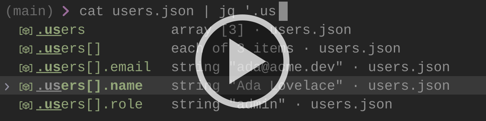

# ezlo

**ezlo is a talking hat for your terminal.** It perches on top of your zsh prompt and, as you type, it shows a live completion dropdown, explains and sanity-checks the line before you hit Enter, learns from what you actually run, and turns common chores into fill-in-the-blanks recipes.

Everything it knows about a command comes from small declarative `.ezlo` files (plus your shell history and zsh's own completion system), so teaching it a new tool is a few lines of text, not a plugin. Inspired by [fig](https://github.com/withfig/autocomplete) and [navi](https://github.com/denisidoro/navi). Written in Rust.

> [!WARNING]
> ezlo is at `0.x.x`: the CLI, the `.ezlo` language, the config format and the shell integration may change in any release, without a migration path.

> [!NOTE]
> **Built with AI.** More than 95% of ezlo's code was written by AI coding agents, with a human steering, reviewing and testing. For an AI-free alternative, check out [navi](https://github.com/denisidoro/navi).

## Install

See [Installation](docs/install.md) for prebuilt binaries and installation options.

## Highlights

- **[Completion](docs/completion.md)**: an inline dropdown with rich rows (branch subjects, container states, file sizes…), fish-style ghost text, signature hints and a preview pane. Works even without a spec for assignments, `$VAR`s, nested commands and pipelines.
- **[Line insight](docs/line-insight.md)**: unknown flags and missing paths underlined as you type, effect previews (`rm *.log` → `12 files · 3.4 MB`), instant values, and a token-by-token explanation (`Alt-H`).
- **[Learning](docs/learning.md)**: suggestions ranked by what you run, where, and how often; failing commands sink; `Ctrl-Space` on an empty prompt recalls what you usually run here; `Ctrl-R` searches history inline.
- **[Recipes](docs/recipes.md)**: `ezlo pick` (`Ctrl-G`) fills command templates like `git rebase <remote>/<branch>` from live data.
- **[One small language](docs/specs.md)**: `.ezlo` files describe types, command grammars and recipes, and layer on top of the bundled ones. [Tooling](docs/spec-tooling.md) validates them, drafts them from `--help`, and detects drift.

## Documentation

| Guide | What's inside |
|---|---|
| [Installation](docs/install.md) | Homebrew, Cargo, prebuilt binaries, and the Zsh hook |
| [Completion](docs/completion.md) | The dropdown, ghost text, history rows, signature hint, preview pane, and spec-less contexts |
| [Line Insight](docs/line-insight.md) | Live diagnostics, `Alt-H` explain, and effect previews |
| [Learning](docs/learning.md) | Usage memory, repo-scoped ranking, failure penalties, and empty-prompt recall |
| [Recipes & `ezlo pick`](docs/recipes.md) | Writing recipes and using the inline picker |
| [Writing Specs](docs/specs.md) | The `.ezlo` language: types, commands, options, arguments, and recipes |
| [Spec Tooling](docs/spec-tooling.md) | Spec locations and layering, `ezlo check`, `ezlo import`, and drift detection |
| [Shell Integration & Keys](docs/shell.md) | Zsh setup, keybindings, and `zstyle` styling |
| [Configuration](docs/configuration.md) | Every `config.toml` option |
| [CLI Reference](docs/cli.md) | All `ezlo` subcommands |
| [Editor Support](docs/editor.md) | The VS Code syntax extension for `.ezlo` files |
| [Architecture](docs/architecture.md) | Daemon, engine, store, and the wire protocol |

Writing specs with an AI agent? Point it at [`skills/spec/`](skills/spec/SKILL.md), an [agent skill](https://agentskills.io) that teaches the `.ezlo` language and how to port completions from zsh, fish, Fig, navi, man pages and `--help` output.

## Why "ezlo"?

In *The Legend of Zelda: The Minish Cap*, Ezlo is a grumpy sage turned into a green, beaked cap who sits on Link's head for the whole adventure, giving advice nobody asked for and occasionally saving the day. Same job here, minus the grumpiness.
