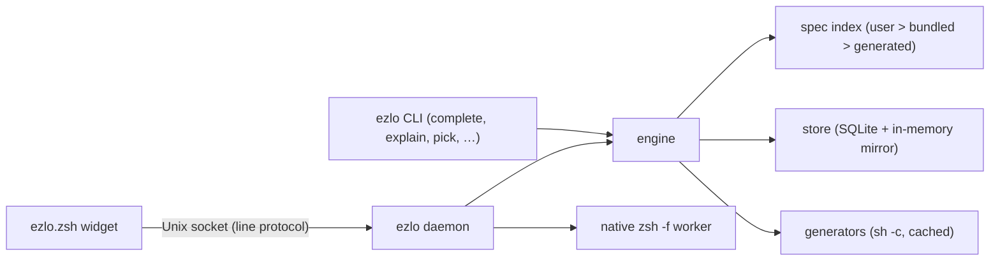

# Architecture

A high-level map of how ezlo works, for contributors and the curious.

---

## Components

- **Zsh widget** (`shell/ezlo.zsh`): hooks into zle, sends the buffer and cursor to the daemon on each edit, and draws the response (dropdown, ghost text, diagnostics highlighting, signature, previews) with `POSTDISPLAY` and `region_highlight`. Responses are read asynchronously, so typing never blocks; stale responses are dropped by id.
- **Daemon** (`src/daemon/`): one per user, shared by every Zsh session over a Unix socket. It keeps the merged spec index, generator caches and the usage store in memory, watches user spec directories for hot reload, and keeps per-session state (environment, aliases, last candidates). Slow work (generator refreshes, preview panes) runs in the background and is pushed when ready.
- **Engine** (`src/engine/`): pure completion logic, shared by the daemon and the CLI:
  1. `line/` tokenizes the buffer, splits pipelines and lists, expands aliases and skips wrappers/assignments.
  2. `walker/` walks the words against the spec grammar: subcommands, options, values, positionals, nested `cmd` slots. It records what slot the cursor is in and each word's role.
  3. Candidate sources fill that slot: `types/` (spec types and built-ins), `options.rs`, `learned.rs`, `recipe.rs`, `assign.rs`, `params.rs` (`$VAR` names), `pipeline/`, `composite.rs`.
  4. `rank/` fuzzy-matches and scores candidates with usage data, and `rank/layout.rs` lays out rows (shared by the dropdown and `ezlo pick`).
  5. Side outputs: `diagnostics.rs`, `explain.rs`, `signature.rs`, `preview/` (blast radius, `instant/` in-process previews, `safety.rs` risky-line warnings, dry-runs, preview pane).
- **Specs** (`src/spec/`): lexer, parser and validator for `.ezlo` files, plus layer merging (`SpecIndex::merge_tiers`).
- **Store** (`src/store/`): SQLite database (`ezlo.db`) of usage, history and failures, mirrored in memory so ranking never touches disk on a keystroke.
- **Native fallback** (`src/shell/zsh/native.rs`): a persistent `zsh -f` worker in a PTY that runs zsh's completion system for commands without a spec.
- **Tab** (`shell/ezlo.zsh`, `src/daemon/session/native_rows.rs`): zsh's completion runs in the user's shell with `compadd` wrapped to record the matches; the shell sends them as `NATIVE`, the daemon lays them out as ordinary rows, and the picked row is inserted by replaying its `compadd` call.
- **Picker** (`src/tui/`): the `ezlo pick` inline `ratatui` UI.
- **Import** (`src/import/`): sandboxed `--help` probing (Landlock + seccomp on Linux, `sandbox-exec` on macOS), help scraping, spec rendering, and drift detection.

---

## Wire protocol

The widget and daemon talk in a simple line protocol: one message per line, fields separated by `\x1f`, a tag first. The main messages:

| Direction | Tag | Purpose |
|---|---|---|
| shell → daemon | `Q` | Completion query (buffer, cursor, cwd, …) |
| daemon → shell | `R` | Response header (replace range, counts, signature, …), followed by `W` (rows), `D` (diagnostics) and `P` (effect preview: `P effect`, `P value`, `P info`, `P dryrun`, `P warning`) lines |
| shell → daemon | `EXEC` / `STATUS` / `ACCEPT` | Learning signals: executed line, exit status, accepted candidate |
| shell → daemon | `EXPLAIN` | Explain request, answered with `E`/`L` lines |
| shell → daemon | `RECALL` | Empty-prompt recall, answered with a normal `R` response |
| shell → daemon | `PANE` | Preview pane for one row, answered asynchronously with `V` + `L` lines |
| shell → daemon | `TRANSLATE` | Comment line → suggested commands via the `[complete.translate]` program (empty line: cancel), answered asynchronously: on success an `R` with one `translated` row per command (replacing the whole line) plus `T ok`, on failure `T err` + `L` message. No progress heartbeats: socket traffic restarts zle's `KEYTIMEOUT`, which would swallow a lone `Esc` |
| shell → daemon | `SET` | This shell's setting overrides from the `Alt-E` settings menu (replacing earlier ones), answered with `S` (the config's values) |

Encoding and parsing live in one place (`src/daemon/protocol.rs`). New fields are appended so older responses still decode.

---

## Design principles

- **Zsh only**: the widget is the one interactive frontend; the one-shot CLI exists for scripting and debugging.
- **Never block typing**: anything that can be slow (generators, previews, dry-runs) has a timeout, a cache, or runs in the background.
- **Never guess side effects**: ezlo only runs commands that specs explicitly declare (generators, previews, dry-runs). Instant previews and pipeline inspection read the filesystem in-process (bounded) and never run anything, words that need the shell to run code (`$(…)`) aren't evaluated, and `--help` probing is sandboxed.
- **One declarative language**: features are expressed in `.ezlo` files rather than per-tool code.
